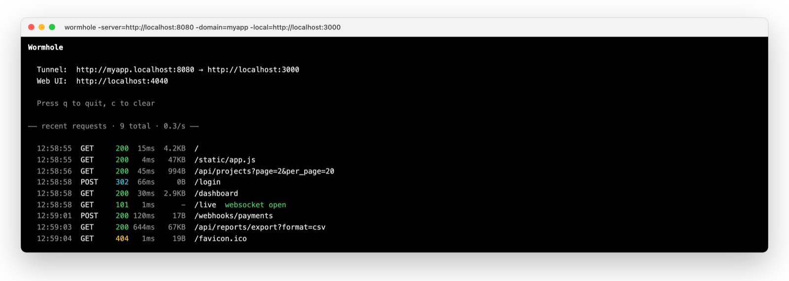
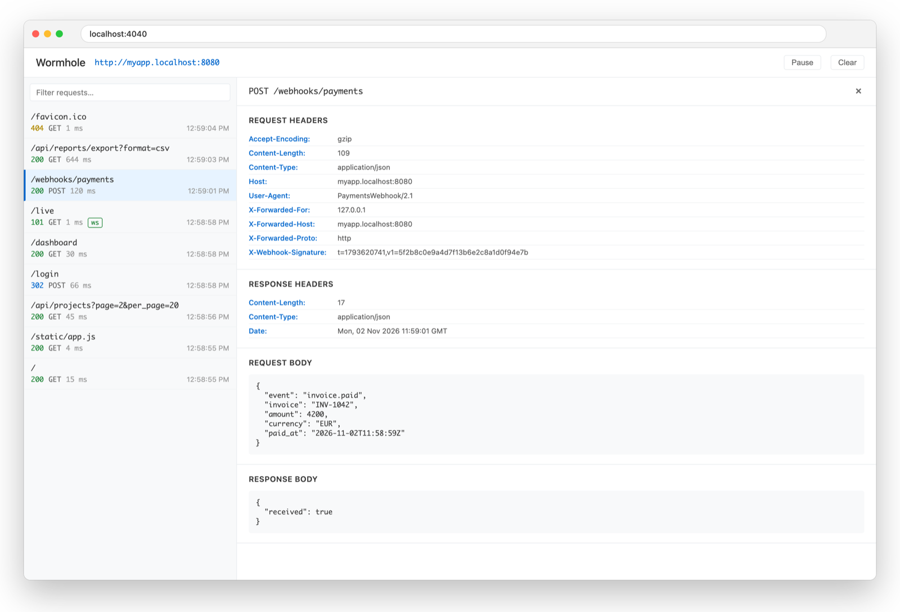
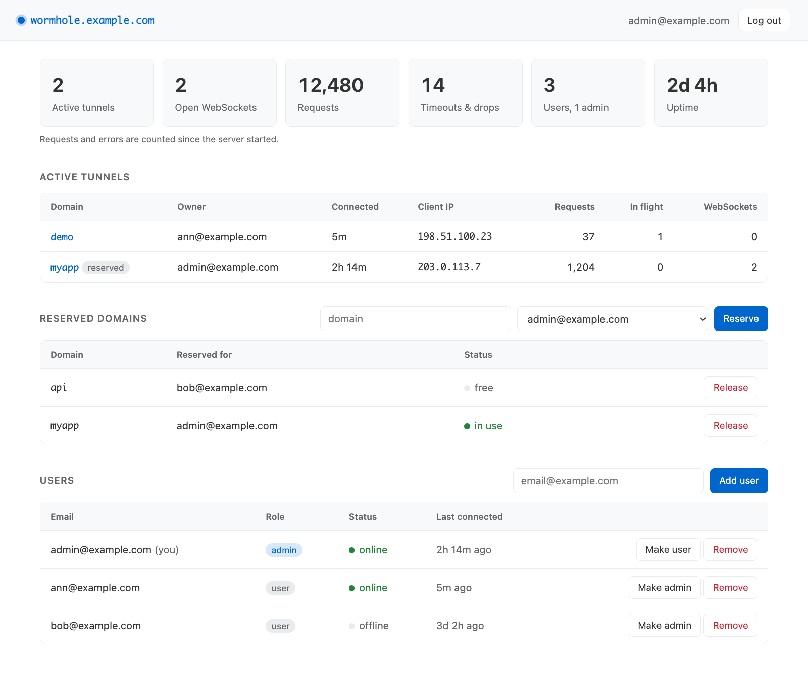
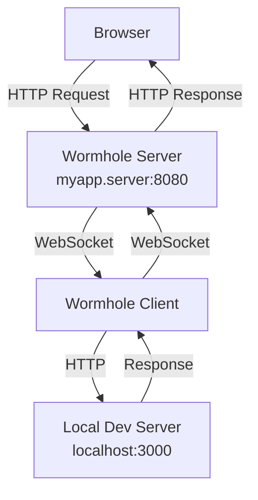

# Wormhole 🕳️

[](https://github.com/dbackowski/wormhole/actions/workflows/test.yml)

A simple HTTP tunneling tool that exposes your local development server to the internet through custom subdomains.



## What it does

Wormhole creates a tunnel between your local development server and the internet, allowing you to:

- Share your local web application with others instantly
- Test webhooks and APIs that require public URLs
- Demo your work-in-progress applications
- Access your local development environment from anywhere

## Quick Start

### 1. Start the server
```bash
go run cmd/server/main.go
```

### 2. Connect your local app
```bash
go run cmd/client/main.go -server=http://localhost:8080 -domain=myapp -local=http://localhost:3000
```

### 3. Access your app
Your local server is now available at: `http://myapp.localhost:8080`

## Installation

### Download Pre-built Binaries

Download the latest release for your platform from the [Releases](https://github.com/dbackowski/wormhole/releases) page. Pre-built binaries are provided for Linux and macOS (amd64 and arm64). Archives are named `wormhole-<client|server>-<linux|darwin>-<amd64|arm64>.tar.gz`; the client archive contains `wormhole`, the server archive `wormhole-server`.

The client's default server, `wormhole.tools`, is private and requires a token. Run your own (see [Quick Start](#quick-start) or [Self-Hosting](#self-hosting)) and point the client at it with `-server`.

**Other platforms:** The client also builds from source on FreeBSD, OpenBSD, NetBSD and DragonFly BSD. Windows is not supported natively; run the Linux binary under [WSL](https://learn.microsoft.com/windows/wsl/) instead. The server builds on any platform Go supports.

**Linux:**
```bash
tar -xzf wormhole-client-linux-amd64.tar.gz
chmod +x wormhole
./wormhole -server=https://yourdomain.com -domain=myapp -local=http://localhost:3000
```

**macOS:**

The binaries are not signed with an Apple Developer certificate. After downloading, you need to remove the quarantine attribute:

```bash
tar -xzf wormhole-client-darwin-arm64.tar.gz
xattr -d com.apple.quarantine wormhole
chmod +x wormhole
./wormhole -server=https://yourdomain.com -domain=myapp -local=http://localhost:3000
```

Alternatively, you can right-click the binary in Finder, select "Open", and confirm in the dialog.

### Build from Source

```bash
git clone https://github.com/dbackowski/wormhole.git
cd wormhole
make build
```

This produces `bin/client/wormhole` and `bin/server/wormhole-server`.

To install the client to `/usr/local/bin` so `wormhole` works from anywhere:

```bash
make build
sudo make install
```

Pass `PREFIX` to install elsewhere, e.g. `make install PREFIX=$HOME/.local`. Remove it with `sudo make uninstall`.

To run the test suite:

```bash
make test
```

## Usage

### Server Options
```bash
go run cmd/server/main.go -port=8080
```

**Optional flags:**
- `-port`: Port to run the server on (default: 8080)
- `-host`: Public hostname of this server (e.g. `wormhole.tools`). When set, `/health` and `/admin` are only served on this host (or when addressed by IP or as `localhost`, so health probes work); requests to `<name>.<host>` are tunneled to the matching client, and any other `Host` (a foreign domain, a nested subdomain) is rejected with `400`. **Required for any deployment on a real domain** — see the note below.
- `-db`: SQLite database holding the allowlist and client tokens (default: `wormhole.db` in the working directory; the Docker image uses `/data/wormhole.db`). Only used when login is enabled, see [Authentication](#authentication)
- `-debug`: Enable debug logging. Each request adds its header names and body sizes, never header values or bodies; query strings are left out at every level
- `-version`: Print version and exit

> **Note on `-host`:** When `-host` is unset, the server falls back to a heuristic — any `Host` containing a dot is treated as a tunnel subdomain. This works for local development (`*.localhost`) and bare-IP access, but on a real domain it has two consequences: requests to your apex (e.g. `wormhole.tools/health`) are treated as a tunnel and return `502` instead of serving `/health` and `/admin`, and the apex's first label (`wormhole`) becomes a reserved subdomain that shadows any client claiming it. Set `-host` to your public hostname in production to route exactly.

### Client Options
```bash
go run cmd/client/main.go -server=http://localhost:8080 -domain=mysubdomain -local=http://localhost:3000
```

**Required flags:**
- `-domain`: Your unique subdomain name: lowercase letters, digits and hyphens, up to 63 characters, no dots
- `-local`: URL of your local development server

**Optional flags:**
- `-server`: Server URL (default: https://wormhole.tools, a private server that requires a token)
- `-auth-token`: Client token to connect with, instead of logging in through the browser (for scripts and CI). A rejected token makes the client exit rather than start a login
- `-webui-port`: Port for the Web UI dashboard (default: 4040)
- `-version`: Print version and exit

> **Note:** Unlike the server, the client does not read environment variables. It takes its configuration from flags or from `~/.wormhole/config` (see [Authentication](#authentication)).

## Features

✅ **Custom Subdomains** - Choose your own subdomain name  
✅ **Real-time Tunneling** - Instant request forwarding via WebSockets  
✅ **WebSocket Passthrough** - WebSockets your app serves work through the tunnel, with their messages shown in the Web UI  
✅ **Header Forwarding** - End-to-end headers are forwarded; hop-by-hop headers are stripped, `Host` is set to the tunnel host, and `X-Forwarded-For`/`-Proto`/`-Host` are added so your local app sees the original client IP and public URL (standard proxy behavior)  
✅ **Multiple Clients** - Support for multiple simultaneous tunnels  
✅ **Automatic Cleanup** - Domains are released when clients disconnect  
✅ **Automatic Reconnect** - The client retries with exponential backoff if the connection drops  
✅ **Live Terminal View** - The client lists recent requests in the terminal, as many as fit the window; press `q` to quit, `c` to clear  
✅ **Web UI Dashboard** - Monitor tunneled requests in a browser at `http://localhost:4040`  
✅ **Google Login** - Only emails on an allowlist you manage at `/admin` can open tunnels  

## Example Use Cases

- **Frontend Development**: Share your React/Vue/Angular app with team members
- **API Testing**: Test webhook endpoints from external services
- **Mobile Development**: Test your local API with mobile apps
- **Client Demos**: Show work-in-progress to clients without deployment

## Web UI

When the client is running, a dashboard is available at `http://localhost:4040` where you can:

- See the active tunnel URL
- View recent requests with method, path, status code, duration (how long your local app took to respond), and timestamp
- Inspect request/response headers and bodies
- See query parameters and form-encoded request bodies (`application/x-www-form-urlencoded`) decoded as name/value pairs, with the raw body still shown
- For WebSockets: see whether each socket is open, the bytes and message counts in each direction, and its recent messages (text, JSON, binary as hex, close codes)
- Freeze the list with the **Pause** button when requests arrive faster than you can click them; **Resume** catches up
- Keep reading a selected request under busy traffic: its details stay open after it has left the history
- Clear the request history with the **Clear** button (also clears the terminal view)



To use a different port:
```bash
go run cmd/client/main.go -server=http://localhost:8080 -domain=myapp -local=http://localhost:3000 -webui-port=5050
```

## Authentication

When `GOOGLE_CLIENT_ID` and `GOOGLE_CLIENT_SECRET` are set, clients must log in with Google, and only emails on the server's allowlist get in. Without them, login is disabled and any client can connect, which suits local development.

### Setting up Google login

1. In the [Google Cloud Console](https://console.cloud.google.com/apis/credentials), create an OAuth client of type **Web application** with the redirect URI `https://yourdomain.com/auth/callback` (for local testing also `http://localhost:8080/auth/callback`). Publish the consent screen; the `openid` and `email` scopes need no verification.
2. Start the server with the client ID and secret in the environment (see [Docker](#docker) and [Fly.io](#flyio)).
3. On first start the database has no admin, and the server logs a one-time setup link:
   ```
   level=WARN msg="No admin yet. Open this link and log in with Google to become the admin" url=https://yourdomain.com/admin/setup?code=...
   ```
   Open it and log in with Google: that account becomes the admin. A restart before then logs a new link, and the old one stops working.
4. Manage the allowlist at `https://yourdomain.com/admin`: add or remove emails and make other users admins. There is always at least one admin. Admins are on the allowlist too.

The admin page also shows the server's state: active tunnels with their owner, client IP and request counts, open WebSockets, who is online, and requests and errors since the server started. A client that loses its connection and reconnects keeps its tunnel's connect time and request count, and the page shows how many times it reconnected. These numbers live in memory, so a restart or deploy resets them.



Removing a user revokes their client tokens and closes their open tunnels at once. Their client's reconnect is then refused, and it exits.

### Reserved domains

By default anyone on the allowlist can use any free subdomain. In the admin page's **Reserved domains** section you can reserve one for a user, say `damian` for `damian@example.com`: from then on only that user can open a tunnel on `damian.yourdomain.com`. Anyone else is refused with `403`, and their client exits with:

```
Domain "damian" is reserved for another user. Please choose another one with -domain.
```

Reserving a domain that someone else is using closes their tunnel at once. Admins are bound by reservations too; to hand a domain to someone else, release it and reserve it again. Removing a user releases their domains.

### Logging in from the client

The first time you run the client against a server with login enabled, it opens your browser to log in with Google:

```
$ wormhole -domain=myapp -local=http://localhost:3000
Log in to wormhole.tools in your browser. If it does not open, visit:

  https://wormhole.tools/cli/login?...

Logged in as you@gmail.com.
```

If your email is on the allowlist, the client saves its token to `~/.wormhole/config` (as `AUTH_TOKEN=...`, readable only by you) and connects. Later runs use the saved token. When the server rejects it, for example after an admin removed you and added you back, the client logs in again.

Each login gets its own token, so logging in on a second machine does not log out the first. To log out, delete the `AUTH_TOKEN` line.

The browser is sent back to a temporary listener on `127.0.0.1`, so it must run on the same machine as the client. On a machine you reach over SSH, log in on your own computer and copy `~/.wormhole/config` over, or pass the token with `-auth-token`.

## How it works



1. The server listens for client connections and HTTP requests
2. Clients connect via WebSocket and claim a subdomain
3. HTTP requests to `subdomain.server:port` are forwarded to the client over WebSocket
4. The client forwards requests to your local server and returns responses
5. A WebSocket handshake is forwarded the same way. Once your local server accepts it, the raw connection is relayed in both directions over the same tunnel until either side closes it

## Server Endpoints

| Endpoint | Description |
|----------|-------------|
| `/health` | Health check, returns `OK`. Served on the server's own host only |
| `/admin` | Admin panel: active tunnels, server stats, and the allowlist. Served on the server's own host only, when login is enabled |
| `/cli/login`, `/cli/token`, `/auth/callback`, `/admin/*` | Google login for the client and the admin panel |
| `/*` | Everything else is tunneled to the matching subdomain client |

Client connections are not a path. The server recognizes them as WebSocket upgrades carrying the `X-Wormhole-Client` header, at whatever path the client dialed, so no path is reserved on your tunnel.

### Status codes

Statuses the server returns for tunneled requests, rather than passing through from your local app:

| Status | Meaning |
|--------|---------|
| `400 Bad Request` | The `Host` header has no subdomain to route on |
| `413 Request Entity Too Large` | Request body exceeds 10 MB |
| `502 Bad Gateway` | No client is connected for the subdomain, the tunnel dropped mid-request, or the local server was unreachable, too slow, or returned a body over 10 MB |
| `503 Service Unavailable` | The client is already handling 64 concurrent requests, or the tunnel already has 100 open WebSockets |
| `504 Gateway Timeout` | No response from the client within 15 seconds |

## Self-Hosting

To run your own Wormhole server, you need:

1. **Wildcard DNS** - Point `*.yourdomain.com` to your server so that subdomain-based routing works
2. **TLS termination** - Wormhole does not handle TLS natively. Use a reverse proxy like Caddy or nginx to terminate TLS
3. **Run the server** with `-host` set to your public hostname so apex requests (`/health`, `/admin`) are routed correctly:
   ```bash
   ./wormhole-server -port=8080 -host=yourdomain.com
   ```

> **Shared servers and cookies:** All tunnels on your server are subdomains of one domain, so unless that domain is on the [Public Suffix List](https://publicsuffix.org/), browsers treat them as one site. Any tunnel can then set cookies (via `Set-Cookie` or JavaScript) that every other tunnel receives, enabling session fixation and CSRF-token overwrites, and `SameSite` does not separate them. This does not matter if only you or your team use the server. If untrusted users share it, [submit your domain to the list](https://github.com/publicsuffix/list/wiki/Guidelines) (private section).

> **Forwarded headers behind TLS termination:** The server adds `X-Forwarded-Proto` to each tunneled request. Because TLS is terminated by your reverse proxy, an inbound `X-Forwarded-Proto` (set by Caddy/nginx) is always honored; when absent, the value defaults to `https` if `-host` is set and `http` otherwise. `X-Forwarded-For` appends the incoming peer to any existing chain, so configure your proxy to forward the real client IP.

### Docker

```bash
docker build -t wormhole .
docker run -p 8080:8080 -v wormhole-data:/data -e WORMHOLE_HOST=yourdomain.com \
  -e GOOGLE_CLIENT_ID=... -e GOOGLE_CLIENT_SECRET=... wormhole
```

The server reads `WORMHOLE_HOST` from the environment (equivalent to the `-host` flag, which takes precedence), and `GOOGLE_CLIENT_ID` and `GOOGLE_CLIENT_SECRET` from the environment only, so the secret stays out of the process command line.

### Fly.io

The repository includes a `fly.toml` for deployment to Fly.io. Set your `FLY_API_TOKEN` as a GitHub secret for automatic deploys on push to main.

Before the first deploy with login enabled, create the volume for the database and set the Google credentials:

```bash
fly volumes create wormhole_data --region fra --size 1
fly secrets set GOOGLE_CLIENT_ID=... GOOGLE_CLIENT_SECRET=...
```

The database is SQLite on that volume, so the app must run on a single machine.

## Limitations

- **WebSockets are uncompressed** - The client removes `Sec-WebSocket-Extensions` from the handshake so that `permessage-deflate` is never negotiated, which lets the Web UI read the messages. Your app sees no compression offered
- **100 open WebSockets per tunnel** - Beyond that the server returns `503 Service Unavailable`
- **Slow WebSocket readers are disconnected** - The tunnel has no per-socket flow control. If one side of a socket stops reading while about 2 MB is waiting for it, that socket is closed so it cannot stall the rest of the tunnel
- **WebSockets end when the tunnel drops** - If the client loses its connection to the server, its open sockets are closed; your app's own reconnect logic takes over from there
- **No built-in TLS** - Requires a reverse proxy for HTTPS
- **10 MB request body limit** - Requests larger than 10 MB are rejected with `413 Request Entity Too Large`
- **10 MB response body limit** - Responses larger than 10 MB from your local server are rejected with `502 Bad Gateway`. Bodies travel base64-encoded inside a WebSocket frame capped at 16 MB, which is what sets both limits
- **10 second request timeout** - The client gives up on your local server after 10 seconds and returns `502 Bad Gateway`. The server independently stops waiting after 15 seconds and returns `504 Gateway Timeout`
- **64 concurrent requests per tunnel** - Beyond that the client returns `503 Service Unavailable` until a slot frees up
- **Request history keeps the last 500 requests** - Older ones drop out of the terminal view and the Web UI. Each stored body is cut to its first 64 KB; the Web UI says when one was truncated. Your app always receives the full body
- **Redirects are passed through unchanged** - The client does not follow redirects from your local server. A `Location` header pointing at `http://localhost:3000` is sent to the browser as-is, taking it off the tunnel. Configure your app to emit relative redirects, or to build absolute URLs from the `X-Forwarded-Host` and `X-Forwarded-Proto` headers
- **Reconnect is time-limited** - If the connection drops, the client retries with exponential backoff (500 ms up to 30 s) for 5 minutes, then exits with status 1, so a supervisor such as systemd `Restart=on-failure` can restart it. If the server rejects the token (say an admin removed you), the client stops retrying immediately; run it again to log in. Requests in flight when the connection drops fail with `502 Bad Gateway`
- **Older clients can be delayed reconnecting after an unclean drop** - If the connection dies without closing cleanly (laptop sleep, Wi-Fi drop), the server only notices when its heartbeat times out, up to 30 seconds later. Current clients reclaim their own subdomain immediately: each client process sends a random session secret on every dial, and the server replaces a stale connection registered with the same secret. Clients up to `v1.0.5` do not send it, so they see the subdomain as taken until the timeout and keep retrying, so they recover on their own

## Requirements

- Go 1.25 or later
- A client and server from the same release line. A client older than the server's WebSocket support does not answer WebSocket handshakes, so they fail with `504 Gateway Timeout` after 15 seconds. Clients up to `v1.0.5` identified themselves by connecting to `/ws`; the server now requires the `X-Wormhole-Client` header, so those clients cannot register and fail with `websocket: bad handshake`. Upgrade the client
- Available port for the server (default: 8080)
- Local development server to tunnel

## License

Released under the MIT License.

## Contributing

Feel free to open issues and submit pull requests to improve Wormhole!
